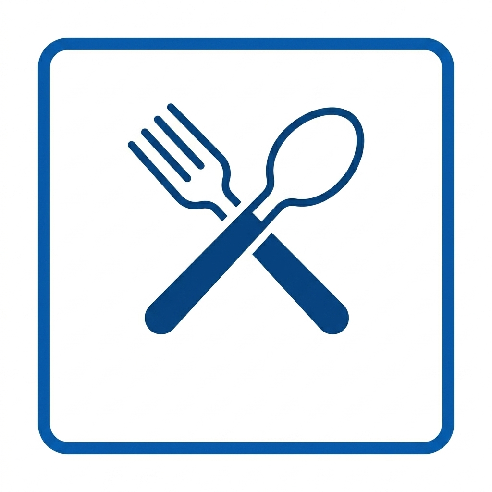

# Spoons and Forks

<p align="center">
  
</p>

<h1 align="center">Spoons and Forks</h1>

<p align="center">Local-first calorie and macro tracking powered by Tauri 2, Groq, and Google Gemini</p>

<p align="center">
  <a href="https://github.com/Horrid-12/Spoons-and-Forks/releases/latest"></a>
  <a href="https://opensource.org/licenses/MIT"></a>
  <a href="https://tauri.app/"></a>
  <a href="https://v2.tauri.app/"></a>
  <a href="https://supabase.com/"></a>
  <a href="https://react.dev/"></a>
  <a href="https://www.typescriptlang.org/"></a>
</p>

## Navigation

<a href="#features">Features</a> ·
<a href="#architecture">Architecture</a> ·
<a href="#preview">Preview</a> ·
<a href="#get-started">Get Started</a> ·
<a href="#installation">Installation</a> ·
<a href="#contributing">Contributing</a> ·
<a href="#security">Security</a> ·
<a href="#license">License</a>

[](https://gitdiagram.com/horrid-12/spoons-and-forks?utm_source=readme&utm_medium=picture)

##  Features

###  AI Logging

- Parse natural language meal descriptions into structured macros
- Validate edibility before logging entries
- Use Groq as the fast primary provider, with automatic Gemini fallback
- Choose from configurable Groq and Gemini models in Settings

###  Statistics & Insights

- Dedicated analytics view with 7-day, 30-day, 90-day, and all-time filters
- Daily calorie chart with a target line, average intake, highest/lowest day, and target-hit rate
- Protein, carbohydrate, and fat trends, macro target completion, and macro distribution
- Activity heatmap, current/longest logging streaks, active days, and entries per day
- Most-logged descriptions, time-of-day distribution, and weekday versus weekend averages
- Averages count logged days only. Unlogged days and today's in-progress day are missing data, never zero-calorie days.

###  Custom Theming

- Customize app colors directly in settings
- Support for Material You (Monet) dynamic colors on Android 12+

###  Local-First Storage

- SQLite backend via Tauri SQL plugin for offline access
- No account required; entries stay on your device
- Meal descriptions are sent only to your configured AI provider when you log an entry

###  Sync and Cloud Backup

- Secure authentication and sync via Supabase
- Pull-then-push sync preserves deletion states

###  Cross-Platform

- Native desktop on Windows, macOS, and Linux via Tauri 2
- Android mobile app sharing the same codebase

##  Architecture

Spoons and Forks uses a modern Tauri 2 architecture with a React + TypeScript frontend and a Rust backend. For implementation details, see the [Architecture.md](Architecture.md) file if present, or review the source in src/ and src-tauri/.

| Layer | Stack |
|---|---|
| Frontend |     |
| Runtime |   |
| Database |  |
| Backend Services |  |
| AI | Groq API + Google Gemini (automatic failover) |

##  Get Started

### Prerequisites

- Node.js (v18+)
- Rust & Cargo (v1.77.2+)
- Android SDK & NDK (for mobile compilation)

### Clone and Install

```bash
git clone https://github.com/Horrid-12/Spoons-and-Forks.git
cd spoons-and-forks
npm install
```

### Environment Configuration

Create .env from .env.example with the following variables:

| Variable | Required | Description |
|---|---|---|
| VITE_SUPABASE_URL | Yes | Supabase project URL |
| VITE_SUPABASE_KEY | Yes | Supabase anon/public key |

### AI Provider Setup

Meal parsing is configured inside the app under Settings:

- **Groq (recommended)** — create a free key at [console.groq.com/keys](https://console.groq.com/keys). The default model is Llama 3.1 8B Instant, with Llama 3.3 70B and GPT-OSS 120B available.
- **Gemini (fallback)** — add an `AIza...` key from [Google AI Studio](https://aistudio.google.com/apikey). It is used automatically when Groq is unavailable.
- Both keys can be stored at once. A provider's key is sent only to that provider.
- If you sign in to Supabase, both keys are included in the synced settings payload.

### Run Commands

- Run Desktop App (React + Tauri Window):
  ```bash
  npm run tauri dev
  ```
- Run Android Dev (Emulator/Device):
  ```bash
  npx tauri android dev
  ```
- Check TypeScript Errors:
  ```bash
  npx tsc --noEmit
  ```
- Build Desktop Installers:
  ```bash
  npm run build && npm run tauri build
  ```
- Build Android APK/AAB:
  ```bash
  npx tauri android build
  ```

<details>
<summary>Windows PowerShell</summary>

```powershell
# Clone
git clone https://github.com/Horrid-12/Spoons-and-Forks.git
cd spoons-and-forks
npm install

# Run desktop
npm run tauri dev

# Build
npm run build; npm run tauri build
```
</details>

##  Installation

| Platform | Status | Notes |
|---|---|---|
| Windows | Available | Download from [Releases](https://github.com/Horrid-12/Spoons-and-Forks/releases) |
| macOS | Available | Download from [Releases](https://github.com/Horrid-12/Spoons-and-Forks/releases) |
| Linux | Available | Download from [Releases](https://github.com/Horrid-12/Spoons-and-Forks/releases) |
| Android | Available | Download APK from [Releases](https://github.com/Horrid-12/Spoons-and-Forks/releases) |

##  Contributing

Contributions, issues, and feature requests are welcome. Please check the [issues page](https://github.com/Horrid-12/Spoons-and-Forks/issues).

##  Security

For security information and reporting guidelines, see [SECURITY.md](SECURITY.md).

##  License

This project is licensed under the MIT License — see the [LICENSE](LICENSE) file for details.

---

<p align="center">Made by Howwid</p>

##  Preview

<p align="center">
  
  <br>
  <sub>Spoons and Forks application identity</sub>
</p>
